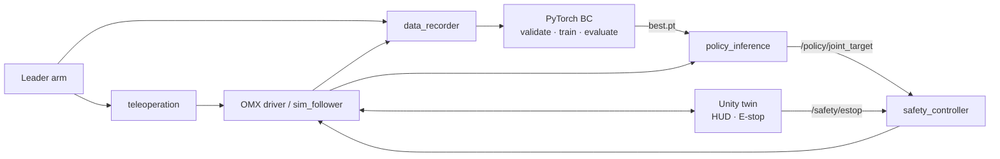
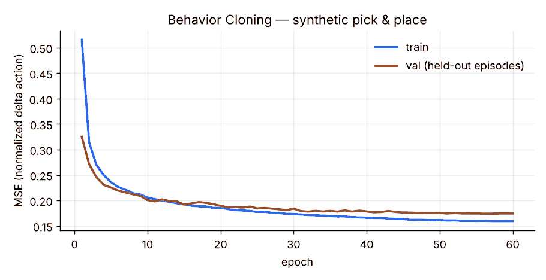

# Physical AI Robot × Unity Digital Twin

[](../../actions/workflows/ci.yml)


> An end-to-end Physical AI platform for robotic manipulation: leader–follower teleoperation,
> demonstration recording, Behavior Cloning in PyTorch, safety-gated ROS 2 deployment,
> and a Unity digital twin that **measures** its own sync error.

사람이 리더 로봇팔로 시범을 보이면 → 데이터를 기록하고 → PyTorch 모방학습 정책을 훈련해 →
안전 계층을 거쳐 OpenMANIPULATOR-X가 스스로 Pick & Place를 수행하고,
그 과정 전체를 Unity 디지털 트윈에서 실시간으로 검증하는 프로젝트입니다.

---

## 핵심 포인트

| | |
|---|---|
| **End-to-end 파이프라인** | 텔레오퍼레이션 → 기록 → 검증 → 학습 → 평가 → ROS 2 배포가 하나의 저장소에서 재현됩니다 |
| **안전 우선 배포** | AI 출력은 *목표값*일 뿐, 모터 명령은 `safety_controller`(관절 제한·속도 제한·E-stop·watchdog)가 결정합니다 |
| **하드웨어 없이 개발** | `sim` / `replay` / `hardware` / `teleop` 4가지 모드를 launch 인자 하나로 전환 |
| **측정되는 디지털 트윈** | Unity가 실제 관절값을 타임스탬프와 함께 되돌려 보내 동기화 오차·왕복 지연을 계산합니다 |
| **테스트·CI** | 안전 필터와 학습 파이프라인 단위 테스트, ROS 2 `colcon build`를 GitHub Actions에서 검증 |

## 아키텍처



자세한 토픽 표와 설계 결정은 [`docs/architecture.md`](docs/architecture.md)를 참고하세요.

## 빠른 시작 (하드웨어 없이)

```bash
pip install -r requirements.txt
./scripts/run_demo.sh          # 합성 데모 200개 생성 → 검증 → 학습 → 평가
pytest -q                      # 단위 테스트
```

ROS 2 Jazzy 환경이라면:

```bash
./scripts/setup.sh             # 워크스페이스 + ROS-TCP-Endpoint 빌드
./scripts/run_demo.sh --ros    # sim_follower + policy + safety 폐루프 실행
UNITY=true ./scripts/run_demo.sh --ros   # Unity 트윈까지 연결
```

실제 로봇 데이터 수집·배포 절차는 [`docs/demo-guide.md`](docs/demo-guide.md),
하드웨어 준비는 [`docs/hardware-setup.md`](docs/hardware-setup.md)에 있습니다.

## 현재 결과 (합성 데이터 · 시뮬레이션 기준)

> 아래 수치는 `generate_synthetic.py`로 만든 데이터와 1차 지연 팔로워 모델 기준입니다.
> **실제 OMX 하드웨어 결과는 측정 후 별도 표로 추가합니다.**

| 지표 | 값 |
|---|---|
| 학습 / 검증 에피소드 | 160 / 40 (에피소드 단위 분리) |
| Open-loop MAE / RMSE | 0.0066 / 0.0097 rad |
| 관절별 MAE (j1–j4, gripper) | 0.0066 · 0.0108 · 0.0058 · 0.0057 · 0.0041 |
| Closed-loop 태스크 성공률 | **60 %** (40회 중 24회, 허용오차 0.08 rad) |



One-step 오차는 매우 작지만 폐루프 성공률은 60%에 그칩니다. 작은 오차가 누적되어
분포 밖 상태로 벗어나는 **compounding error**가 단순 Behavior Cloning의 대표적 한계이며,
이 저장소의 다음 단계(액션 청킹·DAgger·ACT)가 이를 개선하는 것을 목표로 합니다.

## 저장소 구조

```
├── learning/                 PyTorch 모방학습
│   ├── models/bc_policy.py   MLP 정책 (정규화 내장, delta action)
│   ├── dataset.py            에피소드 로딩·검증·에피소드 단위 분리
│   ├── generate_synthetic.py 하드웨어 없는 Pick & Place 데모 생성
│   ├── train.py / evaluate.py / plot_loss.py / validate_dataset.py
│   └── configs/bc_default.json
├── ros2_ws/src/
│   ├── robot_bringup/        demo.launch.py(4개 모드), sim_follower, episode_replayer
│   ├── teleoperation/        리더→팔로워 릴레이
│   ├── data_recorder/        start/stop/discard 서비스로 .npz 에피소드 저장
│   ├── policy_inference/     학습된 정책 → /policy/joint_target
│   ├── safety_controller/    safety_filter.py(ROS 무의존, CI 테스트) + 노드
│   └── unity_bridge/         ROS-TCP endpoint + 트윈 동기화 텔레메트리
├── unity/PhysicalAIRobotTwin RobotTwinController · TelemetryHUD · EStopButton
├── tests/                    안전 필터·학습 파이프라인 테스트
├── docs/                     아키텍처·데이터 포맷·하드웨어·데모 가이드
└── .github/workflows/ci.yml
```

## 평가 지표

| 항목 | 측정 방법 | 위치 |
|---|---|---|
| 태스크 성공률 | pick 자세 도달(그리퍼 닫힘) 후 place 자세 도달(그리퍼 열림) | `learning/evaluate.py` |
| 관절 예측 오차 | open-loop MAE / RMSE | `learning/evaluate.py` |
| 추론 지연 | 정책 forward 시간 | `/policy/latency_ms` |
| 트윈 동기화 오차 | 실제 vs Unity 관절 max-abs | `/twin/sync_error_rad` |
| ROS↔Unity 왕복 지연 | 원본 stamp echo | `/twin/latency_ms` |
| 안전 개입 빈도 | `clamped` / `rate_limited` / `stale` 비율 | `/safety/status` |

## 로드맵

- [x] 학습 파이프라인 (합성 데이터) + 안전 필터 + 테스트·CI
- [x] ROS 2 노드: 텔레옵·기록·추론·안전·sim·replay
- [x] Unity 트윈 스크립트: 관절 동기화·HUD·E-stop
- [ ] 실제 OMX 데모 수집 및 하드웨어 결과표
- [ ] Unity 씬 + 시연 영상 (실물 | 트윈 | HUD)
- [ ] 액션 청킹 / DAgger로 compounding error 개선
- [ ] 카메라 기반 물체 인식으로 `/task/context` 대체
- [ ] ACT · Diffusion Policy 비교, Unity 합성 데이터 증강

## Tech stack

ROS 2 Jazzy · Python 3.11 · PyTorch · Unity 2022.3 (ROS-TCP-Connector, URDF-Importer) · C# ·
ROBOTIS OpenMANIPULATOR-X · Dynamixel · GitHub Actions

## License

MIT
