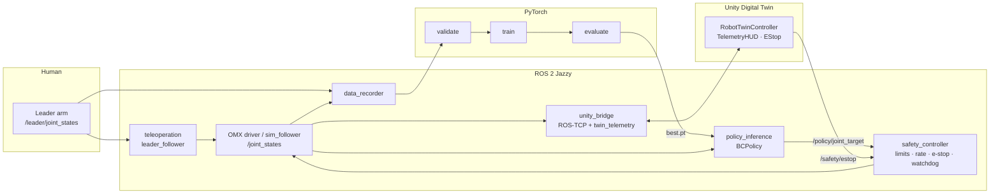

# Architecture

## Design decisions

- **The policy never talks to motors.** `policy_inference` publishes a *target*;
  `safety_controller` decides the executed command (clamp → rate-limit → e-stop / stale hold).
  The filter is pure Python so it is unit-tested in CI without ROS.
- **Three run modes** (`sim`, `replay`, `hardware`) + `teleop` share one launch file, so
  Unity and learning work can proceed without the robot.
- **Same dynamics everywhere.** `sim_follower`, `generate_synthetic.py` and `evaluate.py`
  use the same first-order follower model, so offline and sim numbers are comparable.
  Real-hardware numbers are always reported separately.
- **Delta actions + task context.** Predicting `target − current` generalizes better than
  absolute targets; the context vector stands in for perception (object/goal pose) until a
  camera pipeline is added.
- **Twin sync is measured, not assumed.** Unity echoes its actual joint positions with the
  original stamp → `/twin/sync_error_rad`, `/twin/latency_ms`.

## Topics

| Topic | Type | Producer → Consumer |
|---|---|---|
| `/joint_states` | `sensor_msgs/JointState` | driver / sim → recorder, policy, safety, Unity |
| `/leader/joint_states` | `sensor_msgs/JointState` | leader arm → teleop, recorder |
| `/task/context` | `std_msgs/Float32MultiArray` | perception / sim → recorder, policy |
| `/policy/joint_target` | `sensor_msgs/JointState` | policy → safety |
| `/arm_controller/joint_trajectory` | `trajectory_msgs/JointTrajectory` | safety / teleop → driver |
| `/gripper/command` | `sensor_msgs/JointState` | safety / teleop → gripper adapter |
| `/safety/estop` | `std_msgs/Bool` | Unity / operator → safety |
| `/safety/status` | `std_msgs/String` | safety → Unity HUD |
| `/unity/joint_states` | `sensor_msgs/JointState` | Unity → twin_telemetry |
| `/twin/sync_error_rad`, `/twin/latency_ms`, `/policy/latency_ms` | `std_msgs/Float32` | → Unity HUD |

> Topic and joint names follow the OMX ROS 2 driver defaults but differ between driver
> versions — adjust `ros2_ws/src/robot_bringup/config/robot.yaml`. The OMX gripper is
> usually driven by a `GripperCommand` action; `/gripper/command` is a thin adapter point.
